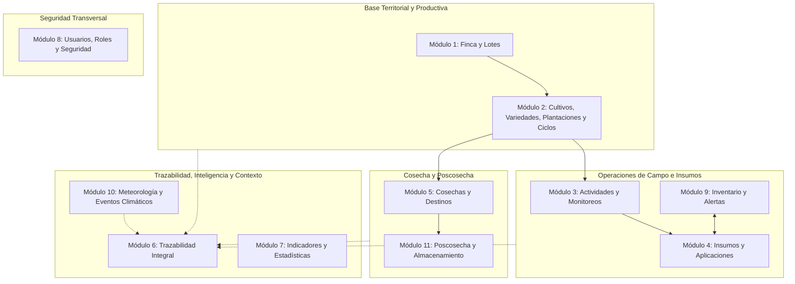
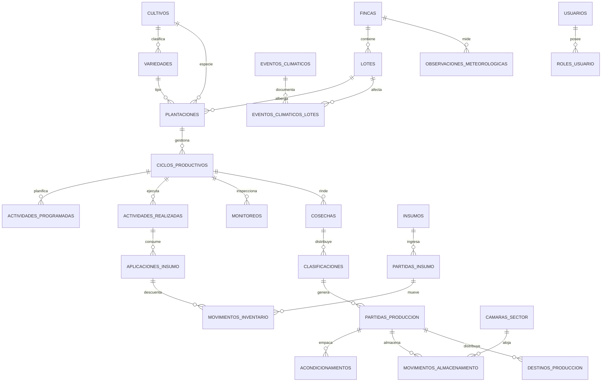

# 📑 Agrul (SGTA) — Especificación Técnica Formal del Sistema
**Sistema de Gestión y Trazabilidad Agrícola**  
**Versión:** 2.0.0  
**Fecha:** 2026-10-26  
**Contexto Operativo:** Fincas agrícolas (San Isidro de Lules, Tucumán — referencia Frutilla y Arándano)  
**Metodología:** Spec-Driven Development, Clean Architecture & JIT Modular Skills  

---

## 1. Visión, Justificación y Alcance del Producto

El **Sistema de Gestión y Trazabilidad Agrícola (SGTA - Agrul)** tiene como propósito centralizar, organizar y relacionar toda la información generada a lo largo del proceso productivo agrícola en una explotación organizada en lotes.

El sistema vincula en una única plataforma integral:
- La estructura física y territorial (**Finca**, **Lotes**).
- La gestión biológica y agronómica (**Cultivos**, **Variedades**, **Plantaciones**, **Ciclos Productivos / Campañas**).
- El trabajo de campo (**Actividades Agrícolas programadas y realizadas**, **Monitoreos técnicos**, **Plagas** y **Recomendaciones**).
- Los recursos utilizados (**Insumos**, **Inventario por partidas con vencimiento**, **Control de stock mínimo** y **Aplicaciones de insumos**).
- La recolección (**Cosechas programadas y realizadas** con pasadas sucesivas y pesajes reales en kg).
- Las operaciones de poscosecha (**Clasificación en Fresco, Industria y Descarte**, **Pérdidas**, **Acondicionamiento/Empaque** e **Ingreso/Salida de Almacenamiento en cámaras frigoríficas**).
- Las finalidades comerciales (**Destinos de producción: Mercado Fresco, Industria, Otro**).
- El contexto agroclimático (**Observaciones meteorológicas** y **Eventos climáticos adversos con impacto por lote**).
- La seguridad y auditoría (**Usuarios, Roles, Permisos y Bitácora histórica inmutable**).

### Límites y Exclusiones del Sistema
- **Instalación:** Cada instalación del sistema administra una **única finca**.
- **Exclusiones Explícitas:** Quedan fuera del alcance la gestión contable y financiera (facturación, saldos bancarios), liquidación de sueldos (RRHH), cotizaciones y órdenes de compra comercial, logística de transporte/vehículos, mantenimiento electromecánico de maquinaria y sensores IoT automáticos.
- El sistema registra las relaciones productivas necesarias para la trazabilidad completa, sin gestionar la venta ni la facturación comercial.

---

## 2. Modelo de Dominio y Glosario Canónico

Para resolver cualquier ambigüedad técnica y homogeneizar el lenguaje de dominio entre el equipo de desarrollo, agrónomos y productores, se establece el siguiente modelo conceptual:

### Glosario de Entidades Fundamentales

| Término | Definición en Agrul | Equivalente / Alias |
| :--- | :--- | :--- |
| **Finca** | Explotación agrícola global administrada por la instalación. Posee una superficie total fija. | Campo, Establecimiento |
| **Lote** | Porción delimitada de tierra dentro de la finca. Tiene código, superficie (ha), suelo y riego. | Parcela, Cuartel |
| **Cultivo** | Especie vegetal registrada (ej: Frutilla o Arándano). Se clasifica según su ciclo de vida (`ANUAL` o `PERENNE`). | Especie |
| **Variedad** | Clasificación agronómica específica dentro de un cultivo (ej: variedad de frutilla o arándano). | Cultivar |
| **Plantación** | Establecimiento físico de un cultivo y variedad en un lote específico (con fecha, superficie ocupada y cantidad de plantas). | Implantación |
| **Ciclo Productivo** | Campaña productiva asociada a una plantación. Posee fechas planificadas y efectivas. | Campaña |
| **Actividad Agrícola** | Labor de campo (preparación, riego, fertilización, poda, etc.) ejecutable con o sin programación previa. | Labor, Tarea |
| **Monitoreo Agrícola** | Inspección técnica en campo (etapa fenológica, estado del cultivo, plagas detectadas y recomendaciones). | Inspección técnica |
| **Insumo** | Producto químico, orgánico o material utilizado en las labores (fertilizantes, fitosanitarios, etc.). | Producto agrícola |
| **Partida de Insumo** | Lote o bulto de ingreso de un insumo con fecha de ingreso, cantidad, proveedor y fecha de vencimiento. | Partida de insumo |
| **Aplicación de Insumos** | Registro del consumo real de uno o más insumos durante una actividad realizada, con descuento automático de inventario. | Aplicación |
| **Cosecha** | Recolección física de fruta en kilogramos reales, asociada a un ciclo productivo y lote, con número de pasada. | Cosecha realizada |
| **Clasificación** | Distribución de los kg cosechados en: `Fresco`, `Industria` y `Descarte` (con causas de pérdida). | Selección / Triaje |
| **Partida de Producción** | Cantidad de producción aprovechable (`Fresco` o `Industria`) resultante de una clasificación. | Partida clasificada |
| **Acondicionamiento** | Preparación y empaque de la producción aprovechable (tipo de preparación, envases, bandejas/cajas). | Empaque |
| **Almacenamiento** | Control de ingresos, salidas y saldos físicos de producción en cámaras frigoríficas o sectores. | Frío / Guarda |
| **Destino de Producción** | Finalidad dada a la producción aprovechable (`Mercado fresco`, `Industria` u `Otro`), descontada de disponibilidad. | Despacho / Destino |
| **Evento Climático** | Suceso adverso (helada, granizo, viento fuerte) con registro de daños específicos por lote afectado. | Contingencia climática |

---

## 3. Arquitectura Modular: Los 11 Módulos Funcionales

### Mapeo de Módulos vs. Requerimientos Funcionales y Casos de Uso

| Módulo | Nombre | Requerimientos | Casos de Uso (CU) | Actores Principales |
| :--- | :--- | :--- | :--- | :--- |
| **M1** | Gestión de Finca y Lotes | RF-M1-01 a RF-M1-10 | CU01 - CU06 | Administrador |
| **M2** | Cultivos, Variedades, Plantaciones y Ciclos | RF-M2-01 a RF-M2-16 | CU07 - CU21 | Administrador |
| **M3** | Actividades Agrícolas y Monitoreos | RF-M3-01 a RF-M3-14 | CU22 - CU33 | Administrador / Encargado de campo |
| **M4** | Insumos y Aplicaciones | RF-M4-01 a RF-M4-13 | CU34 - CU40 | Administrador / Encargado de campo |
| **M5** | Cosechas y Destinos de la Producción | RF-M5-01 a RF-M5-17 | CU41 - CU46, CU53 - CU54 | Encargado de campo / Administrador |
| **M6** | Gestión de Trazabilidad Agrícola | RF-M6-01 a RF-M6-12 | CU56 - CU57 | Administrador / Encargado de campo |
| **M7** | Indicadores y Estadísticas Productivas | RF-M7-01 a RF-M7-13 | CU58 | Administrador / Encargado de campo |
| **M8** | Gestión de Usuarios y Seguridad | RF-M8-01 a RF-M8-11 | CU59 - CU62 | Administrador del Sistema / Usuarios |
| **M9** | Inventario de Insumos y Alertas | RF-M9-01 a RF-M9-20 | CU63 - CU66 | Encargado de campo / Administrador |
| **M10**| Meteorología y Eventos Climáticos | RF-M10-01 a RF-M10-12 | CU67 - CU70 | Encargado de campo |
| **M11**| Poscosecha y Almacenamiento | RF-M11-01 a RF-M11-18 | CU47 - CU52 | Encargado de campo / Administrador |

---

## 4. Reglas de Negocio Invariantes (RN-01 a RN-30)

1. **RN-01 (Finca Única):** La instalación gestiona una única finca con identificador y superficie global inmutable salvo modificación explícita.
2. **RN-02 (Pertenencia y Unicidad de Lotes):** Todo lote pertenece a la finca y su código es único en el sistema (incluso entre lotes inactivos).
3. **RN-03 (Consistencia Territorial):** La suma de las superficies de lotes no inactivos jamás puede superar la superficie total de la finca. No se admiten superposiciones.
4. **RN-04 (Desactivación de Lotes):** Un lote solo puede pasar a `INACTIVO` si está en estado `DISPONIBLE` y no tiene ciclos productivos activos en curso.
5. **RN-05 (Integridad Histórica de Catálogos):** Cultivos y variedades inactivos conservan intactos sus vínculos con plantaciones y ciclos pasados.
6. **RN-06 (Vinculación de Plantaciones):** Toda plantación debe vincularse obligatoriamente a un lote, un cultivo activo y una variedad activa.
7. **RN-07 (Ciclos y Plantaciones):** Todo ciclo productivo pertenece a una plantación. En cultivos perennes (arándano), una plantación alberga múltiples ciclos a lo largo de los años.
8. **RN-08 (Estados de Ciclos):** Máquina de estados estricta: `PLANIFICADO -> ACTIVO -> FINALIZADO`.
9. **RN-09 (Cierre de Ciclos Limpio):** No puede finalizarse un ciclo productivo que tenga actividades agrícolas programadas en estado `PENDIENTE`. Deben ejecutarse o cancelarse previamente.
10. **RN-10 (Flexibilidad Operativa de Actividades):** Una labor agrícola puede originarse de una programación previa o registrarse directamente como ejecutada en campo.
11. **RN-11 (Atribución Obligatoria):** Toda actividad realizada se vincula a un lote, ciclo productivo activo, fecha y usuario responsable.
12. **RN-12 (Auditoría de Cancelaciones):** Las actividades canceladas conservan su registro histórico con motivo y no se computan como ejecutadas.
13. **RN-13 (Monitoreos Desacoplados):** Un monitoreo puede sugerir acciones recomendadas sin disparar automáticamente órdenes de aplicación no validadas.
14. **RN-14 (Consumo de Insumos Vinculado):** Toda aplicación de insumos debe respaldarse en una actividad agrícola efectivamente realizada (`CU30`).
15. **RN-15 (Inmutabilidad de Unidades):** La unidad de medida de un insumo no puede modificarse si ya tiene aplicaciones registradas.
16. **RN-16 (Trazabilidad de Movimientos de Insumo):** Todo movimiento de inventario (ingreso, ajuste, pérdida, aplicación) identifica insumo, partida, cantidad y responsable.
17. **RN-17 (Prohibición de Saldos Negativos en Insumos):** El inventario de insumos no admite existencias negativas bajo ninguna circunstancia.
18. **RN-18 (Flexibilidad de Cosechas):** Una cosecha puede originarse en una jornada programada o registrarse de forma directa no programada.
19. **RN-19 (Multicosecha / Pasadas):** Un mismo ciclo genera múltiples cosechas sucesivas (pasadas de recolección) en distintas fechas sin sobrescribir antecedentes.
20. **RN-20 (Clasificación Tripartita Estricta):** Los kg recibidos en clasificación deben ser iguales a la suma exacta de: `kgFresco + kgIndustria + kgDescarte`.
21. **RN-21 (Conservación de Masa en Poscosecha):** Las cantidades clasificadas, acondicionadas, almacenadas o destinadas jamás superan los kilogramos disponibles de la etapa anterior.
22. **RN-22 (Aislamiento de Descarte):** El descarte representa pérdidas con motivo registrado y queda estrictamente excluido de empaque, almacenamiento y comercialización.
23. **RN-23 (Trazabilidad de Almacenamiento):** Todo ingreso y salida de cámaras frigoríficas conserva la referencia de la partida de producción y lote de origen.
24. **RN-24 (Límite de Destinos):** Las cantidades asignadas a destinos no pueden superar la producción aprovechable disponible fuera de almacenamiento.
25. **RN-25 (Trazabilidad Bidireccional Completa):** Reconstrucción inmediata tanto aguas arriba (*trace-back* hacia lote y labores) como aguas abajo (*trace-forward* hacia destinos).
26. **RN-26 (Preservación Histórica):** La desactivación lógica de entidades jamás destruye relaciones históricas ni altera balances anteriores.
27. **RN-27 (Diferenciación de Nulos vs Ceros en Reportes):** Los indicadores productivos distinguen taxativamente entre "falta de datos" (no registrado) y valor medido igual a 0.
28. **RN-28 (Consistencia Meteorológica):** Los registros climáticos validan rangos físicos (humedad 0-100%, lluvia >= 0 mm, no duplicados en misma fecha/hora).
29. **RN-29 (Principio de Menor Privilegio):** Roles segregados (`Administrador`, `Encargado de campo / Ingeniero agrónomo`, `Administrador del sistema`).
30. **RN-30 (Inmutabilidad Legal de Eventos):** Registro append-only protegido por triggers de PostgreSQL ante intentos de `UPDATE` o `DELETE` directos.

---

## 5. Diseño del Esquema de Persistencia Relacional (PostgreSQL / Drizzle ORM)

El esquema de datos se divide en dominios cohesivos con tipado estricto alineado al diccionario de datos:

### Tablas Principales

#### 1. Módulo 1 & 2: Estructura Territorial y Agronómica
- `fincas`: `id (uuid)`, `nombre`, `provincia`, `departamento`, `localidad`, `ubicacion`, `superficie_total (numeric 8,2)`, `propietario`, `telefono`, `observaciones`.
- `lotes`: `id (uuid)`, `finca_id (fk)`, `codigo (varchar 10, uk)`, `nombre`, `superficie (numeric 8,2)`, `ubicacion_sector`, `tipo_suelo`, `sistema_riego`, `estado (DISPONIBLE, EN_PRODUCCION, INACTIVO)`.
- `cultivos`: `id (uuid)`, `nombre (varchar 40, uk)`, `tipo_ciclo_vida (ANUAL, PERENNE)`, `descripcion`, `estado (ACTIVO, INACTIVO)`.
- `variedades`: `id (uuid)`, `cultivo_id (fk)`, `nombre (varchar 40)`, `descripcion`, `estado (ACTIVO, INACTIVO)`. UK(`cultivo_id`, `nombre`).
- `plantaciones`: `id (uuid)`, `lote_id (fk)`, `cultivo_id (fk)`, `variedad_id (fk)`, `fecha_plantacion`, `superficie (numeric 8,2)`, `cantidad_inicial_plantas (integer)`, `procedencia`, `estado (ACTIVA, FINALIZADA)`, `fecha_finalizacion`.
- `ciclos_productivos`: `id (uuid)`, `plantacion_id (fk)`, `nombre_codigo (varchar 30)`, `fecha_inicio_prevista`, `fecha_fin_prevista`, `fecha_inicio_efectiva`, `fecha_fin_efectiva`, `responsable_seguimiento_id (fk usuarios)`, `estado (PLANIFICADO, ACTIVO, FINALIZADO)`.

#### 2. Módulo 3: Actividades y Monitoreos
- `tipos_actividad`: `id (uuid)`, `nombre (varchar 40, uk)`, `categoria (PREPARACION_SUELO, PLANTACION, RIEGO, FERTILIZACION, MANTENIMIENTO, CONTROL_SANITARIO, OTRO)`, `descripcion`, `estado (ACTIVA, INACTIVA)`.
- `tipos_actividad_cultivos`: `tipo_actividad_id (fk)`, `cultivo_id (fk)`.
- `actividades_programadas`: `id (uuid)`, `ciclo_id (fk)`, `tipo_actividad_id (fk)`, `fecha_programada`, `responsable_id (fk)`, `superficie_prevista (numeric 8,2)`, `descripcion`, `estado (PENDIENTE, EJECUTADA, CANCELADA)`, `motivo_cancelacion`.
- `actividades_realizadas`: `id (uuid)`, `ciclo_id (fk)`, `actividad_programada_id (fk nullable)`, `tipo_actividad_id (fk)`, `fecha_ejecucion`, `responsable_id (fk)`, `superficie_trabajada (numeric 8,2)`, `duracion_horas (numeric 5,2)`, `descripcion_trabajo`, `datos_especificos (jsonb)`.
- `monitoreos`: `id (uuid)`, `ciclo_id (fk)`, `fecha_inspeccion`, `responsable_id (fk)`, `sector_observado`, `etapa_fenologica`, `estado_general_cultivo`, `tipo_observacion`, `problema_detectado`, `descripcion_hallazgos`, `accion_recomendada`.

#### 3. Módulos 4 & 9: Insumos e Inventario
- `insumos`: `id (uuid)`, `codigo (varchar 15, uk)`, `nombre`, `categoria (FERTILIZANTE, FITOSANITARIO, ENMIENDA, OTRO)`, `tipo_producto`, `unidad_medida (kg, L, etc.)`, `fabricante_marca`, `nivel_minimo (numeric 10,2)`, `estado (ACTIVO, INACTIVO)`.
- `partidas_insumo`: `id (uuid)`, `insumo_id (fk)`, `fecha_ingreso`, `cantidad_inicial (numeric 10,2)`, `cantidad_disponible (numeric 10,2)`, `proveedor`, `fecha_vencimiento (date nullable)`.
- `movimientos_inventario`: `id (uuid)`, `insumo_id (fk)`, `partida_id (fk nullable)`, `tipo_movimiento (INGRESO, EXISTENCIA_INICIAL, AJUSTE_POSITIVO, AJUSTE_NEGATIVO, DEVOLUCION, PERDIDA, EGRESO_APLICACION, REGULARIZACION_CORRECCION)`, `cantidad (numeric 10,2)`, `fecha_movimiento`, `motivo`, `responsable_id (fk)`.
- `aplicaciones_insumo`: `id (uuid)`, `actividad_realizada_id (fk)`, `superficie_tratada (numeric 8,2)`, `metodo_aplicacion`, `motivo_aplicacion`, `responsable_id (fk)`, `observaciones`.
- `aplicaciones_insumo_items`: `id (uuid)`, `aplicacion_id (fk)`, `insumo_id (fk)`, `partida_insumo_id (fk)`, `cantidad_aplicada (numeric 10,2)`, `dosis (numeric 8,2)`.

#### 4. Módulos 5 & 11: Cosecha, Poscosecha y Destino
- `cosechas_programadas`: `id (uuid)`, `ciclo_id (fk)`, `fecha_prevista`, `responsable_id (fk)`, `sector_recoleccion`, `cantidad_estimada_kg (numeric 10,2)`, `estado (PENDIENTE, EJECUTADA, CANCELADA)`.
- `cosechas`: `id (uuid)`, `ciclo_id (fk)`, `cosecha_programada_id (fk nullable)`, `fecha_efectiva`, `sector`, `numero_pasada (integer)`, `cantidad_cosechada_kg (numeric 10,2)`, `responsable_id (fk)`, `origen (PROGRAMADA, NO_PROGRAMADA)`.
- `clasificaciones`: `id (uuid)`, `cosecha_id (fk)`, `fecha_clasificacion`, `cantidad_recibida_kg (numeric 10,2)`, `kg_fresco (numeric 10,2)`, `kg_industria (numeric 10,2)`, `kg_descarte (numeric 10,2)`, `motivos_descarte (jsonb nullable)`, `responsable_id (fk)`.
- `partidas_produccion`: `id (uuid)`, `clasificacion_id (fk)`, `categoria (FRESCO, INDUSTRIA)`, `cantidad_inicial_kg (numeric 10,2)`, `cantidad_disponible_kg (numeric 10,2)`.
- `acondicionamientos`: `id (uuid)`, `partida_produccion_id (fk)`, `fecha_acondicionamiento`, `tipo_acondicionamiento`, `tipo_envase`, `cantidad_kg (numeric 10,2)`, `cantidad_envases (integer)`, `responsable_id (fk)`.
- `camaras_sector`: `id (uuid)`, `nombre (varchar 40, uk)`, `descripcion`, `temperatura_objetivo_c`.
- `movimientos_almacenamiento`: `id (uuid)`, `partida_produccion_id (fk)`, `camara_sector_id (fk)`, `tipo_movimiento (INGRESO, SALIDA)`, `cantidad_kg (numeric 10,2)`, `fecha_movimiento`, `responsable_id (fk)`.
- `destinos_produccion`: `id (uuid)`, `partida_produccion_id (fk)`, `fecha_destino`, `tipo_destino (MERCADO_FRESCO, INDUSTRIA, OTRO)`, `destino_especifico`, `cantidad_destinada_kg (numeric 10,2)`, `responsable_id (fk)`.

#### 5. Módulo 10: Meteorología y Eventos Adversos
- `observaciones_meteorologicas`: `id (uuid)`, `finca_id (fk)`, `fecha_hora_observacion (timestamptz)`, `temperatura_c (numeric 4,1)`, `humedad_relativa (numeric 5,2)`, `precipitaciones_mm (numeric 6,1)`, `observaciones`, `responsable_id (fk)`.
- `eventos_climaticos`: `id (uuid)`, `finca_id (fk)`, `tipo_evento (HELADA, GRANIZO, LLUVIA_INTENSA, VIENTO_FUERTE, OTRO)`, `fecha (date)`, `descripcion`, `responsable_id (fk)`.
- `eventos_climaticos_lotes`: `evento_id (fk)`, `lote_id (fk)`, `descripcion_dano (text)`.

#### 6. Módulo 8: Usuarios, Sesión y Auditoría
- `usuarios`: `id (uuid)`, `nombre`, `apellido`, `nombre_usuario (uk)`, `correo (uk)`, `password_hash`, `rol (ADMINISTRADOR, ENCARGADO_CAMPO, ADMIN_SISTEMA)`, `estado (ACTIVO, INACTIVO)`, `creado_en`.
- `auditoria_modificaciones`: `id (uuid)`, `fecha_hora (timestamptz)`, `usuario_id (fk)`, `tabla`, `registro_id`, `campo`, `valor_anterior`, `valor_nuevo`.
- `eventos_trazabilidad`: Log append-only inmutable protegido con trigger SQL que bloquea `UPDATE` y `DELETE`.

---

## 6. Integración con el Motor de Inmutabilidad y Trazabilidad

1. **Dual Model (Read Model + Event Log):**  
   Cada mutación de estado significativa (alta de cosecha, clasificación, despacho, aplicación de agroquímico, ingreso a cámara) inserta de forma atómica (ACID) en su tabla de proyección correspondiente y en la tabla inmutable `eventos_trazabilidad`.
2. **Conservación de Masa:**  
   En la clasificación de cosechas (`CU47`), `cantidad_recibida_kg === kg_fresco + kg_industria + kg_descarte`. Los kg aprovechables crean `partidas_produccion`, de las cuales emanan los acondicionamientos, ingresos a cámara y destinos, imposibilitando la duplicación o saldo negativo.
3. **Mapeo de Linaje:**  
   La consulta de trazabilidad (`CU56`) reconstruye el árbol genealógico completo enlazando:
   `Destino -> Almacenamiento/Acondicionamiento -> PartidaProduccion -> Clasificacion -> Cosecha -> CicloProductivo -> Plantacion -> Lote/Finca`.

---

## 7. Fases de Ejecución del Backlog

- **Fase 1:** Módulo 1 — Finca y Lotes Territoriales (`CU01` a `CU06`).
- **Fase 2:** Módulo 2 — Cultivos, Variedades, Plantaciones y Ciclos Productivos (`CU07` a `CU21`).
- **Fase 3:** Módulo 8 — Usuarios, Roles y Seguridad (`CU59` a `CU62`).
- **Fase 4:** Módulo 3 — Tipos de Actividades, Labores Programadas/Realizadas y Monitoreos (`CU22` a `CU33`).
- **Fase 5:** Módulos 4 & 9 — Insumos, Inventario FIFO, Alertas y Aplicaciones (`CU34` a `CU40`, `CU63` a `CU66`).
- **Fase 6:** Módulos 5 & 11 — Cosechas, Clasificación Fresco/Industria/Descarte, Acondicionamiento, Almacenamiento en Cámaras y Destinos (`CU41` a `CU54`).
- **Fase 7:** Módulos 6, 7 & 10 — Trazabilidad Integral, Indicadores Productivos (kg/ha) y Meteorología (`CU56`, `CU58`, `CU67` a `CU70`).
