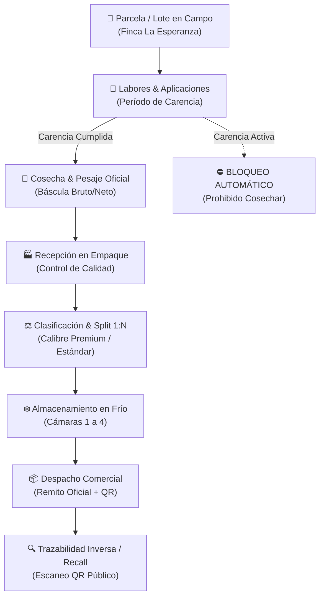

# 📘 Agrul — Manual de Pruebas de Usuario (UAT & Guía Operativa)

> **Versión:** 1.0.0  
> **Sistema:** Agrul — Plataforma Integral de Trazabilidad Agroindustrial y Cadena de Custodia  
> **Audiencia:** Usuarios Finales, Encargados de Finca, Administradores Agrícolas, Inspectores de Calidad y Testers UAT.  
> **Fecha:** Noviembre 2026  

---

## 📑 Tabla de Contenidos
1. [Introducción y Objetivos](#1-introducción-y-objetivos)
2. [Puesta en Marcha del Entorno Local](#2-puesta-en-marcha-del-entorno-local)
3. [Matriz de Roles y Credenciales de Prueba](#3-matriz-de-roles-y-credenciales-de-prueba)
4. [Flujo Operativo General del Producto](#4-flujo-operativo-general-del-producto)
5. [Casos de Prueba Paso a Paso (CP-01 al CP-10)](#5-casos-de-prueba-paso-a-paso)
   - [CP-01: Autenticación, Control de Accesos (RBAC) y Seguridad](#cp-01-autenticación-control-de-accesos-rbac-y-seguridad)
   - [CP-02: Gestión Territorial: Fincas, Lotes y Parcelas](#cp-02-gestión-territorial-fincas-lotes-y-parcelas)
   - [CP-03: Tablero Ejecutivo y Gráficos Interactivos (Chart.js)](#cp-03-tablero-ejecutivo-y-gráficos-interactivos-chartjs)
   - [CP-04: Recetas Agronómicas y Aplicación de Insumos](#cp-04-recetas-agronómicas-y-aplicación-de-insumos)
   - [CP-05: Validación Crítica de Período de Carencia Fitosanitaria](#cp-05-validación-crítica-de-período-de-carencia-fitosanitaria)
   - [CP-06: Cosecha y Pesaje Oficial en Báscula](#cp-06-cosecha-y-pesaje-oficial-en-báscula)
   - [CP-07: Poscosecha, Calibres y División de Lotes (Split 1:N)](#cp-07-poscosecha-calibres-y-división-de-lotes-split-1n)
   - [CP-08: Despacho Comercial y Remito con Código QR](#cp-08-despacho-comercial-y-remito-con-código-qr)
   - [CP-09: Trazabilidad Inversa y Simulación de Recall Sanitario](#cp-09-trazabilidad-inversa-y-simulación-de-recall-sanitario)
   - [CP-10: Auditoría Centralizada, Bitácora Inmutable y Seguridad](#cp-10-auditoría-centralizada-bitácora-inmutable-y-seguridad)
6. [Planilla de Registro de Ejecución de Pruebas](#6-planilla-de-registro-de-ejecución-de-pruebas)

---

## 1. Introducción y Objetivos

Este manual tiene como finalidad guiar a los usuarios y evaluadores de calidad en la ejecución integral de las pruebas de aceptación de usuario (**UAT**) sobre el sistema **Agrul**.

El sistema garantiza la **cadena de custodia inalterable** desde el lote productivo en el campo hasta el empaque, cámara de frío y despacho comercial al cliente final, aplicando normas de Buenas Prácticas Agrícolas (BPA) y trazabilidad alimentaria (GS1 / SENASA).

### Objetivos Clave de la Prueba:
* Validar que la interfaz sea fluida, clara y acorde a la estética **AgTech Light** (fondo claro, tipografía limpia, accesos laterales intuitivos).
* Corroborar el funcionamiento de todos los botones de la barra lateral izquierda (Tablero, Lotes, Clima, Recetas, Labores, Mapa, Auditoría y Manual de Usuario).
* Comprobar la integridad de los datos en gráficos en tiempo real (**Chart.js**) y tarjetas KPI.
* Verificar las **reglas de negocio no negociables**: inmutabilidad de eventos, balance de masa en divisiones (splits) y bloqueo automático de cosecha por carencia fitosanitaria.

---

## 2. Puesta en Marcha del Entorno Local

Si los servicios no se encuentran encendidos en el equipo, siga estos pasos sencillos en la terminal de PowerShell:

### 2.1 Iniciar Base de Datos PostgreSQL
```powershell
& "C:\Program Files\PostgreSQL\18\bin\postgres.exe" -D "$env:USERPROFILE\.agrul_data" -p 5433
```

### 2.2 Iniciar Servidor Fastify & Frontend Agrul
```powershell
cd C:\AGRUL
npx tsx --env-file=.env src/index.ts
```

### 2.3 Acceso Web
Abra cualquier navegador moderno (Google Chrome, Microsoft Edge, Brave o Firefox) e ingrese a:
👉 **`http://localhost:3001`**

---

## 3. Matriz de Roles y Credenciales de Prueba

Agrul implementa un modelo de Control de Acceso Basado en Roles (**RBAC**). Para ejecutar los distintos casos de prueba utilice los siguientes usuarios preconfigurados:

| Rol | Usuario | Contraseña | Perfil Funcional y Permisos |
| :--- | :--- | :--- | :--- |
| **Administrador Agrícola** | `admin` | `admin123` | **Control Total:** Administración de fincas, lotes, tableros ejecutivos, autorización de cosechas, auditoría global y ajustes de sistema. |
| **Encargado de Campo** | `encargado` | `campo123` | **Operativo de Finca:** Registro de labores agrícolas, aplicación de agroquímicos, partes diarios de cosecha y lectura de clima. |
| **Administrador de Sistema** | `sistema` | `admin123` | **Técnico y Auditor:** Gestión de usuarios, seguridad, auditoría de eventos de sistema y parametrización base. |

> [!NOTE]
> La sesión cuenta con un tiempo de expiración por inactividad automático (15 minutos). Si permanece inactivo, el sistema solicitará reingresar sus credenciales protegiendo la información de la explotación.

---

## 4. Flujo Operativo General del Producto

El siguiente diagrama ilustra el ciclo de vida de la materia prima y su trazabilidad inmutable dentro de Agrul:



---

## 5. Casos de Prueba Paso a Paso

---

### CP-01: Autenticación, Control de Accesos (RBAC) y Seguridad

* **Objetivo:** Verificar el inicio de sesión correcto, validación de credenciales inválidas, visibilidad de opciones según el rol y cierre de sesión.
* **Rol:** `admin`, `encargado` y usuario no registrado.
* **Precondición:** Navegador en `http://localhost:3001`.

#### Pasos de Ejecución:
1. En el formulario flotante de login, ingrese:
   - Usuario: `admin`
   - Contraseña errónea: `clave_falsa`
   - Presione el botón **"Ingresar al Sistema"**.
   - **Resultado:** El sistema debe mostrar un mensaje en rojo: *"Credenciales inválidas"*.
2. Ingrese con credenciales válidas:
   - Usuario: `admin`
   - Contraseña: `admin123`
   - Presione **"Ingresar al Sistema"**.
   - **Resultado:** La ventana de login desaparece. Se carga la interfaz principal de Agrul con el saludo del usuario en la barra superior.
3. Observe la barra lateral izquierda y el menú inferior:
   - Verifique que se muestren los iconos de Tablero, Lotes, Labores, Clima, Ajustes/Auditoría (⚙️) y Manual de Usuario (ℹ️).
4. Presione el botón **"Salir"** en la esquina inferior izquierda.
   - **Resultado:** La sesión se destruye en el backend y el formulario de login vuelve a presentarse solicitando credenciales.

> [!TIP]
> **Criterio de Aceptación:** Acceso denegado ante contraseñas falsas, acceso concedido y token JWT almacenado de forma segura ante credenciales correctas.

---

### CP-02: Gestión Territorial: Fincas, Lotes y Parcelas

* **Objetivo:** Comprobar la visualización del inventario de lotes, el filtrado dinámico por estado/finca y la creación de un nuevo lote.
* **Rol:** `admin` o `encargado`.
* **Precondición:** Sesión iniciada como `admin`.

#### Pasos de Ejecución:
1. En la barra de navegación lateral, haga clic en el icono de **Lotes** (segundo botón, cuadrícula o planta 🌱).
2. Observe el inventario en pantalla:
   - Verifique que se listan los lotes existentes (ej. `LOT-2026-00001` - Cereza Lapins, `LOT-2026-00002` - Vid Malbec).
3. Utilice los botones de filtro rápido:
   - Haga clic en la pestaña **"Creados"**, **"En Proceso"**, **"Embalados"**, **"Despachados"** y **"Todos"**.
   - Verifique que la tabla se actualiza instantáneamente sin recargar la página.
4. En el buscador superior, escriba *"Malbec"*.
   - Verifique que sólo se muestran los lotes vinculados a dicho cultivo/variedad.
5. Haga clic en el botón superior **"+ Nuevo Lote"**:
   - Ingrese los datos:
     * **Código Lote:** `LOT-2026-EXP01`
     * **Finca:** Finca La Esperanza
     * **Cultivo / Variedad:** Cereza Lapins
     * **Superficie / Cantidad estimada:** `5000` kg
     * **Temporada:** `2025/2026`
   - Presione **"Guardar Lote"**.
   - **Resultado:** El modal se cierra, se emite una notificación de éxito y el nuevo lote aparece reflejado en el inventario con estado `CREADO`.

> [!IMPORTANT]
> **Criterio de Aceptación:** El código de lote debe ser único. Si intenta registrar un código existente, el sistema debe alertar la duplicidad conforme a las reglas de integridad.

---

### CP-03: Tablero Ejecutivo y Gráficos Interactivos (Chart.js)

* **Objetivo:** Validar la carga de métricas ejecutivas en tiempo real, tarjetas KPI y gráficos de rendimiento.
* **Rol:** `admin`.
* **Precondición:** Sesión activa con datos de cosecha registrados en el sistema.

#### Pasos de Ejecución:
1. Haga clic en el primer botón de la barra lateral (icono de gráfico o tablero 📊).
2. Verifique la presentación del **Tablero Ejecutivo de Inicio**:
   - Tarjeta **"Lotes en Producción"**: Indica superficie total y lotes activos.
   - Tarjeta **"Producción Acumulada"**: Cantidad en kilogramos totales, volumen comercializable y porcentaje de descarte.
   - Tarjeta **"Alertas de Stock"**: Insumos por debajo del punto de pedido crítico.
   - Tarjeta **"Labores Urgentes"**: Labores vencidas o planificadas a vencer en los próximos 7 días.
3. Observe la sección inferior de **Análisis Visual (Chart.js)**:
   - Gráfico 1: *Evolución Mensual de Cosecha (kg)* (Barras comparativas: Bruto vs Neto vs Descarte).
   - Gráfico 2: *Consumo de Insumos por Categoría* (Doughnut / Torta con distribución porcentual).
   - Gráfico 3: *Rendimiento por Cultivo (kg/ha)*.
4. Interactúe con las leyendas de los gráficos:
   - Haga clic sobre la leyenda *"Descarte"* en el gráfico de evolución.
   - Verifique que la serie se oculta/muestra dinámicamente con una animación suave.
5. En la barra de filtros del tablero:
   - Cambie el selector de Finca a una finca específica.
   - Presione el botón **"Actualizar"**.
   - Verifique que los gráficos y las tarjetas recalculan sus valores.

> [!TIP]
> **Criterio de Aceptación:** Los gráficos no deben mostrar áreas en blanco ni errores en consola; la API `/api/v1/dashboard/resumen` debe responder código `200 OK`.

---

### CP-04: Recetas Agronómicas y Registro de Labores de Campo

* **Objetivo:** Planificar una labor agrícola, registrar la aplicación de un insumo fitosanitario y verificar el descuento de stock.
* **Rol:** `admin` o `encargado`.
* **Precondición:** Existencia de insumos en el almacén (ej. Fungicida Cúprico con stock disponible).

#### Pasos de Ejecución:
1. En el menú lateral, seleccione la sección **Labores / Recetas** (icono de calendario 📅 o documento 📄).
2. Presione el botón **"+ Nueva Labor Agrícola"**.
3. Complete los campos requeridos:
   - **Tipo de Labor:** Aplicación Fitosanitaria
   - **Lote de Destino:** `LOT-2026-00001` (Cereza Lapins)
   - **Insumo:** Fungicida Óxido Cuproso 50%
   - **Dosis por Hectárea:** `2.5 kg/ha`
   - **Superficie Aplicada:** `10 ha` (Consumo total: 25 kg)
   - **Fecha de Aplicación:** Fecha de hoy
   - **Período de Carencia Declarado:** `14 días`
   - **Operario / Aplicador:** Juan Pérez (Matrícula aplicador 412)
4. Presione **"Confirmar Aplicación"**.
5. Verifique en el historial de labores del lote que el evento queda registrado con estado `APLICADO`.
6. Diríjase a la sección de **Inventario de Insumos**:
   - Compruebe que el stock del fungicida se redujo exactamente en 25 kg.

> [!NOTE]
> **Criterio de Aceptación:** El registro persiste el evento inmutable y activa el temporizador de carencia del lote.

---

### CP-05: Validación Crítica de Período de Carencia Fitosanitaria

* **Objetivo:** Validar la regla de negocio más crítica de Agrul: **un lote bajo período de carencia fitosanitaria activo NO puede ser cosechado**.
* **Rol:** `encargado` o `admin`.
* **Precondición:** Aplicación fitosanitaria reciente efectuada sobre el lote `LOT-2026-00001` (del CP-04) con 14 días de carencia pendientes.

#### Pasos de Ejecución:
1. En el menú lateral, diríjase a la sección **Cosechas** (o botón de acción *"Registrar Cosecha"* en la fila del lote).
2. Seleccione como origen el lote `LOT-2026-00001`.
3. Ingrese los datos de cosecha:
   - **Fecha de Cosecha:** Fecha actual (día 0 de la carencia).
   - **Kilos Cosechados:** `1500 kg`.
4. Haga clic en **"Registrar Cosecha"**.
5. **Resultado Esperado (Bloqueo de Seguridad):**
   - El sistema debe **RECHAZAR** la transacción con código de error de negocio `CARENCIA_FITOSANITARIA_ACTIVA`.
   - La pantalla debe desplegar un cartel de advertencia en color rojo/ámbar:
     > ⛔ **Cosecha Prohibida por Seguridad Alimentaria (BPA):**  
     > *El lote posee una aplicación de [Fungicida] con período de carencia vigente hasta el [Fecha + 14 días]. Faltan 14 días para autorizar la cosecha comercial.*
   - Verifique que ningún registro de cosecha fue creado en la base de datos.

> [!CAUTION]
> **Criterio de Éxito No Negociable:** Bajo ninguna circunstancia el sistema debe permitir evadir esta restricción. Esta prueba demuestra la conformidad con normativas internacionales de exportación de alimentos.

---

### CP-06: Cosecha y Pesaje Oficial en Báscula

* **Objetivo:** Registrar un pesaje de cosecha conforme a norma una vez superada la carencia (o sobre un lote habilitado).
* **Rol:** `encargado` de campo.
* **Precondición:** Lote con carencia libre (ej. `LOT-2026-00002` Vid Malbec).

#### Pasos de Ejecución:
1. Seleccione el lote `LOT-2026-00002` y presione **"Registrar Cosecha"**.
2. Complete los datos del ticket de báscula oficial:
   - **Peso Bruto del Camión/Bins:** `12.450 kg`
   - **Tara (Camión + Bins vacíos):** `4.200 kg`
   - **Peso Neto Calculado:** `8.250 kg` (verifique que el sistema calcula `Bruto - Tara` automáticamente).
   - **Descarte de Campo estimado:** `250 kg` (3.03%).
   - **Kilos Netos Comercializables:** `8.000 kg`.
   - **Número de Remito / Ticket de Báscula:** `TCK-88412`.
3. Presione **"Guardar Cosecha"**.
4. Verifique:
   - El lote pasa automáticamente a estado `EN_PROCESO` o `COSECHADO`.
   - Se crea el evento de trazabilidad `COSECHA` con timestamp dual (reloj local y reloj del servidor).
   - El Tablero Ejecutivo incrementa en 8.000 kg su producción neta acumulada.

---

### CP-07: Poscosecha, Calibres y División de Lotes (Split 1:N)

* **Objetivo:** Validar la división atómica de un lote padre de cosecha en múltiples lotes hijos por calibre y calidad, verificando la conservación de masa.
* **Rol:** `admin` o responsable de empaque.
* **Precondición:** Lote cosechado de 8.000 kg disponible en planta de empaque.

#### Pasos de Ejecución:
1. En la lista de lotes, ubique el lote cosechado y seleccione la opción **"Procesar / Fraccionar (Split)"**.
2. Defina la especificación de los lotes hijos resultantes:
   - **Hijo 1:** `LOT-2026-00002-A` | Calibre Premium Exportación | `5.000 kg` | Unidad: kg.
   - **Hijo 2:** `LOT-2026-00002-B` | Calibre Estándar Mercado Interno | `2.800 kg` | Unidad: kg.
   - **Merma de clasificación justificada:** `200 kg` (2.5%).
   - **Total asignado:** `5.000 + 2.800 + 200 = 8.000 kg` (Suma exacta del lote padre).
3. Asigne la ubicación de almacenamiento para cada hijo:
   - Hijo 1: Cámara de Frío Nº 1 (0.5 °C).
   - Hijo 2: Cámara de Frío Nº 2 (2.0 °C).
4. Presione **"Confirmar Fraccionamiento"**.
5. **Resultado Esperado:**
   - La operación se ejecuta en una sola transacción ACID atómica.
   - El lote padre queda marcado como fraccionado/cerrado.
   - Aparecen los dos nuevos lotes hijos en el inventario.
   - En la tabla de genealogía se asientan las relaciones padre-hijo con las cantidades aportadas.

> [!WARNING]
> **Prueba Negativa de Conservación de Masa:** Intente realizar un split donde la suma de los hijos sea `8.500 kg` (superando los 8.000 kg del padre). El sistema debe abortar la operación indicando: *"La suma de las partes supera la masa disponible del lote origen"*.

---

### CP-08: Despacho Comercial y Remito con Código QR

* **Objetivo:** Generar una orden de despacho comercial para cliente, cerrar el lote embalado y verificar la emisión del código QR de trazabilidad pública.
* **Rol:** `admin`.
* **Precondición:** Lote `LOT-2026-00002-A` embalado y listo en cámara de frío.

#### Pasos de Ejecución:
1. En el inventario de lotes, seleccione el lote `LOT-2026-00002-A` y elija **"Despachar"**.
2. Complete la orden de despacho:
   - **Cliente / Destinatario:** Supermercados del Sur S.A.
   - **Destino / Puerto:** Centro de Distribución Buenos Aires
   - **Transportista:** Logística Frigorífica Andina
   - **Chofer / Patente:** C. Rodríguez - Dominio AF-123-ZZ
   - **Termógrafo / Registro de Temperatura:** `0.8 °C`
   - **Cantidad Despachada:** `5.000 kg` (totalidad del lote).
3. Presione **"Emitir Despacho y Remito"**.
4. **Resultado:**
   - El lote cambia a estado `DESPACHADO`.
   - Se genera el **Remito Oficial de Trazabilidad**.
   - En pantalla y en el remito imprimible se visualiza un **Código QR dinámico**.
5. Abra la cámara de su teléfono móvil o un lector QR y escanee el código presentado en pantalla:
   - Verifique que la URL apunta a la vista pública de consulta de trazabilidad (ej. `/trazabilidad/publica?lote=LOT-2026-00002-A`).
   - La pantalla móvil debe mostrar al consumidor: Finca de origen, fecha de cosecha, variedad, certificaciones BPA y temperatura de transporte asegurada.

---

### CP-09: Trazabilidad Inversa y Simulación de Recall Sanitario

* **Objetivo:** Ejecutar una reconstrucción de linaje completa aguas arriba (*Trace-Back*) y aguas abajo (*Trace-Forward*) ante un hipotético reclamo de calidad.
* **Rol:** `admin` o auditor de calidad.
* **Precondición:** Lotes fraccionados y despachados en los pasos anteriores.

#### Pasos de Ejecución:
1. En el menú lateral o desde la búsqueda global, ingrese al módulo **"Árbol de Trazabilidad / Linaje"**.
2. Ingrese el código del lote final entregado al cliente: `LOT-2026-00002-A`.
3. Presione **"Rastrear Linaje"**.
4. **Verificación de Linaje Aguas Arriba (Trace-Back):**
   - El grafo debe conectar el lote hijo con su lote padre de cosecha `LOT-2026-00002`.
   - Del lote de cosecha debe remontar a la parcela agrícola: Cuartel Este B2, Finca La Esperanza.
   - Debe listar todas las aplicaciones fitosanitarias, riegos y operarios que intervinieron en esa fruta.
5. **Simulación de Recall Sanitario (Trace-Forward):**
   - Presione el botón **"Simular Retiro de Mercado (Recall)"**.
   - El sistema debe identificar inmediatamente al lote hermano `LOT-2026-00002-B` (que provino de la misma cosecha), indicando su ubicación física exacta (Cámara Nº 2) y si ya fue consumido o distribuido.
   - Presione **"Generar Reporte de Recall"** para exportar el expediente oficial para la autoridad sanitaria.

---

### CP-10: Auditoría Centralizada, Bitácora Inmutable y Seguridad

* **Objetivo:** Verificar que todas las acciones del sistema quedan registradas en la bitácora append-only, comprobar el acceso a los ajustes y verificar el modal del manual de usuario.
* **Rol:** `admin` o `sistema`.
* **Precondición:** Sesión iniciada como `admin`.

#### Pasos de Ejecución:
1. En la barra lateral izquierda, haga clic en el botón de **Ajustes y Auditoría** (icono de engranaje ⚙️, penúltimo botón).
   - **Resultado:** Se abre el modal o sección de **Bitácora de Seguridad y Auditoría**.
2. Verifique que la bitácora registra cronológicamente los eventos ejecutados en las pruebas anteriores:
   - `LOGIN_EXITOSO` del usuario `admin` con dirección IP y User-Agent.
   - `CREACION_LOTE` (`LOT-2026-EXP01`).
   - `APLICACION_INSUMO` (Fungicida Cuproso).
   - `INTENTO_COSECHA_RECHAZADO` (Bloqueo por carencia).
   - `DESPACHO_COMERCIAL` con destino y cliente.
3. Compruebe la inmutabilidad de la bitácora:
   - Verifique que la interfaz **NO provee botones de editar ni de eliminar** filas del historial de eventos.
4. Haga clic en el último botón de la barra lateral izquierda (icono de información ℹ️, **Manual de Usuario**):
   - **Resultado:** Se abre el modal interactivo del **Manual de Usuario y Guía del Sistema Agrul** con sus 6 pestañas operativas:
     * 1. Inicio & Navegación
     * 2. Lotes & Terrenos
     * 3. Labores & Carencia
     * 4. Cosecha & Báscula
     * 5. Frío & Poscosecha
     * 6. Despacho & QR
   - Navegue entre las pestañas y compruebe que el contenido se visualiza sin retraso.
5. Cierre el modal con la cruz superior o presionando la tecla `Escape`.

---

## 6. Planilla de Registro de Ejecución de Pruebas

Imprima o complete esta tabla para la homologación final del sistema:

| ID | Módulo / Escenario | Rol Probador | Resultado (Pasa / Falla) | Observaciones / Número de Ticket | Fecha & Firma |
| :--- | :--- | :--- | :---: | :--- | :--- |
| **CP-01** | Autenticación y RBAC | `admin` / `encargado` | [ &nbsp; ] | | |
| **CP-02** | Gestión de Lotes y Fincas | `admin` | [ &nbsp; ] | | |
| **CP-03** | Tablero Ejecutivo & Chart.js | `admin` | [ &nbsp; ] | | |
| **CP-04** | Labores y Recetas Agronómicas | `encargado` | [ &nbsp; ] | | |
| **CP-05** | Bloqueo por Carencia Fitosanitaria | `encargado` | [ &nbsp; ] | Regla crítica de seguridad alimentaria | |
| **CP-06** | Cosecha y Pesaje en Báscula | `encargado` | [ &nbsp; ] | Cálculo automático de peso neto | |
| **CP-07** | Poscosecha y Split 1:N | `admin` | [ &nbsp; ] | Conservación de balance de masa | |
| **CP-08** | Despacho Comercial y Código QR | `admin` | [ &nbsp; ] | Lectura con smartphone verificada | |
| **CP-09** | Trazabilidad Inversa y Recall | `admin` | [ &nbsp; ] | Rastreo bidireccional de linaje | |
| **CP-10** | Auditoría y Manual de Usuario | `sistema` | [ &nbsp; ] | Apertura de botones ⚙️ e ℹ️ validada | |

---

### Resumen de Conformidad
* **Dictamen Final:** [ &nbsp; ] Aprobado para Producción &nbsp;&nbsp;&nbsp;&nbsp; [ &nbsp; ] Requiere Correcciones
* **Responsable Técnico:** __________________________________
* **Responsable Agronómico / Calidad:** __________________________________
